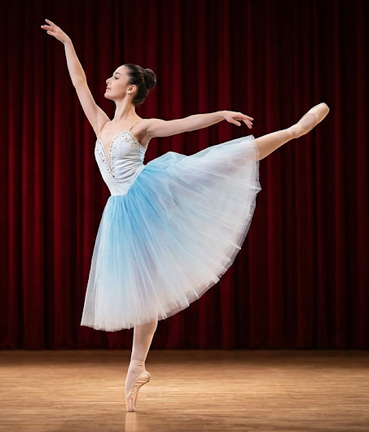
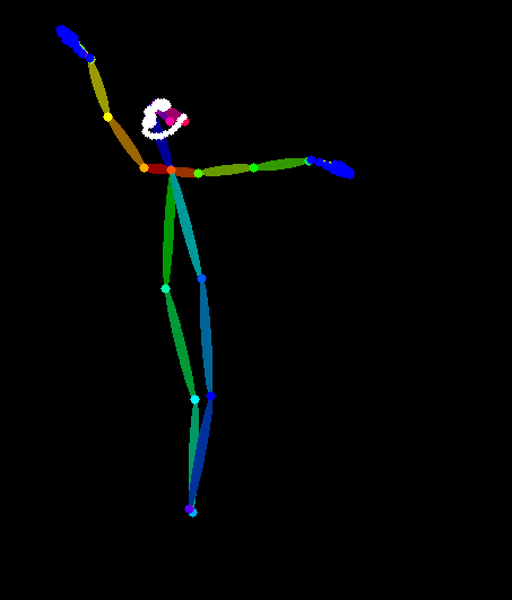
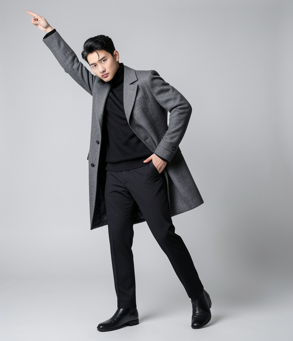
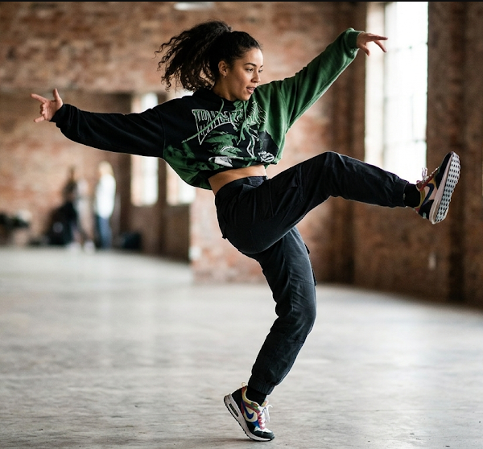
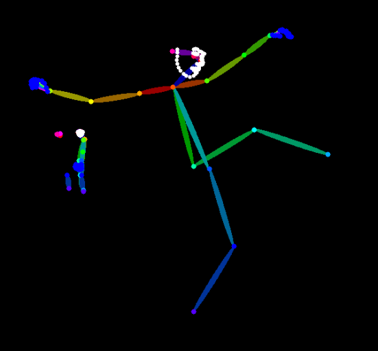
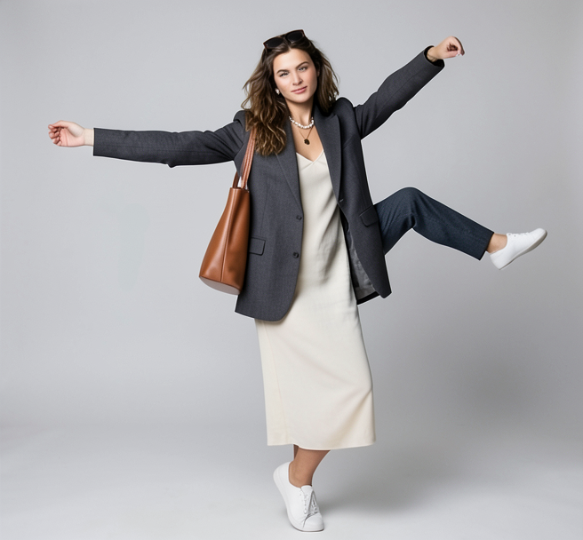

# 원하는 포즈로 이미지 만드는 도구 (FLUX.2-klein 4B + DWPose)

## 도구 설명
- **모델 사진**(누구를)과 **포즈 사진**(어떤 자세로)을 넣으면, 모델 사진 속 인물이 포즈 사진의 자세를 취한 이미지를 만듭니다.
- 포즈 사진에서 **DWPose** 로 관절(뼈대)을 뽑고, 그 뼈대 이미지와 모델 사진을 **FLUX.2-klein 4B 의 참조 이미지 2장**으로 함께 넣어 생성합니다.
- Google Colab 무료 T4 GPU 에서 돌도록 모델을 GGUF Q4 로 줄이고 출력 크기를 약 0.4MP 로 낮췄습니다.

```
포즈 사진 ──DWPose──▶ 뼈대 이미지 ──┐
                                  ├─▶ FLUX.2-klein 4B (참조 2장 + 프롬프트) ─▶ 결과
모델 사진 ────────────────────────┘
```

> 왜 ControlNet 이 아닌가: FLUX.2 에는 BFL 공식 ControlNet 이 없고(2026-07 기준), 커뮤니티판(FLUX.2-dev 기반)은 무료 T4 에 너무 큽니다.
> FLUX.2-klein 에 내장된 multi-reference editing 으로 포즈를 "참조"시키는 방식이라, ControlNet 보다 자세가 덜 정확할 수 있습니다.

## 사용법
1. GitHub 의 `pose_tool.ipynb` 를 Colab 에서 엽니다 (GitHub 파일 화면 → Colab 배지, 또는 Colab → 파일 → 노트 열기 → GitHub).
2. **[런타임 → 런타임 유형 변경 → T4 GPU]** 를 선택합니다.
3. 이 저장소의 `docs/model/`, `docs/pose/` 사진을 내려받아 두고, [5]번 셀의 업로드 창에서 모델 사진 → 포즈 사진 순서로 고릅니다.
4. 셀을 위에서부터 차례로 실행합니다: GPU 확인 → 설치 → 모델 다운로드 → 서버 실행 → 사진 준비 → 포즈 추출 → 생성 함수 → 첫 생성 → 실험 → 저장.
5. 마지막 셀이 내려 주는 `samples.zip` 에서 결과를 확인합니다.

### 무료 Colab 메모리 전략

| 항목 | 값 | 이유 |
|---|---|---|
| 디퓨전 모델 | `flux-2-klein-4b-Q4_K_M.gguf` 2.6GB | GGUF Q4 양자화 |
| 텍스트 인코더 | `Qwen3-4B-Q4_K_M.gguf` 2.5GB (대안: bf16 8GB) | 시스템 RAM 약 12.7GB 에서 가장 큰 부담을 줄임 |
| 출력 크기 | 약 0.4MP, 포즈 사진 비율 유지 | 1024×1024 대비 픽셀 약 40% |
| 참조 이미지 | 0.25MP 로 축소 | 참조도 토큰으로 더해져 메모리 사용 |
| 생성 설정 | 4스텝, cfg 1.0, seed 42 | 증류판 공식 권장값, 시드 고정 |
| OOM 대응 | `TARGET_MP=0.3` → `LOWVRAM=True` | 셀 [3], [4] |

## 저장소 구성

```
├── README.md          # 이 문서
├── pose_tool.ipynb    # Colab 튜토리얼 노트 (핵심)
├── prompts.md         # 실험에 쓴 프롬프트와 설정 기록
├── samples/           # pose_01 ↔ output_01, pose_02 ↔ output_02 (+ 뼈대, 조건 실험 exp*, 설정 JSON)
└── docs/
    ├── model/         # 모델 사진 (AI 생성 이미지)
    ├── pose/          # 포즈 사진 (AI 생성 이미지)
    ├── test/          # 실행 기록 (날짜별 폴더: 실행 이야기, 캡처, 실행된 노트)
    └── mcp-setup.md   # Colab MCP 설치 상세 가이드
```

## Colab MCP 로 실행하기 (선택)

Claude Code 가 브라우저에 열린 Colab 노트북의 셀을 직접 실행하게 하려면 Google 공식 [colab-mcp](https://github.com/googlecolab/colab-mcp) 를 **이 폴더 전용(local)** 으로 등록합니다. 자세한 내용과 문제 해결은 [docs/mcp-setup.md](docs/mcp-setup.md) 에 있습니다.

```bash
# 이 저장소 폴더에서 실행 (local 범위는 실행한 폴더에 묶임)
claude mcp add colab-mcp -s local -- uvx git+https://github.com/googlecolab/colab-mcp

# 확인 — 서버 시작이 30초를 넘으므로 대기 시간을 늘려서 확인
MCP_TIMEOUT=120000 claude mcp list        # Git Bash
$env:MCP_TIMEOUT=120000; claude mcp list  # PowerShell
```

매번 적용되게 하려면 이 폴더의 `.claude/settings.local.json` 에 아래를 둡니다(개인 설정이라 저장소에는 올리지 않음).

```json
{ "env": { "MCP_TIMEOUT": "120000" } }
```

## 테스트 결과

2026-11-11, 무료 Colab Tesla T4(VRAM 14.6GB, RAM 12.7GB)에서 실행했습니다. 설정은 seed 42, 4스텝, cfg 1.0, 출력 약 0.4MP, 텍스트 인코더 GGUF Q4입니다.
첫 장은 모델을 올리느라 50.9초가 걸렸고, 그다음부터는 장당 10~14초였습니다. 실행 과정과 캡처는 [docs/test/202611112103/README.md](docs/test/202611112103/README.md) 에 있습니다.

| 포즈 (참조) | 뼈대 | 결과 | 자세 일치 (눈으로 판단) |
|---|---|---|---|
|  `pose_01` 발레 아라베스크 |  |  `output_01` 남자 모델 | **일부.** 위로 뻗은 팔은 같지만, 옆 팔은 주머니에 들어가 있고 뒤로 든 다리는 재현되지 않음 |
|  `pose_02` 댄스 킥 |  |  `output_02` 여자 모델 | **대체로 같음.** 양팔을 옆으로 뻗고 한 다리를 옆으로 차올림. 얼굴·재킷·가방 유지 |

조건 실험(`samples/exp1_*` ~ `exp4_*`)의 결과와 관찰은 노트 마지막 셀 [11]에 있고, 프롬프트와 실행 기록은 [prompts.md](prompts.md) 에 있습니다.

## 한계

- **뼈대가 틀리면 결과도 틀립니다.** 발레 사진은 튀튀에 가려 DWPose 가 뒤로 든 다리를 잡지 못했습니다. 두 다리가 모두 아래로 겹친 뼈대가 나왔고, 그래서 발레 포즈로 만든 7장 모두 두 다리로 서 있는 자세로 나왔습니다(뼈대를 보고 내린 해석).
- **배경 인물까지 따라 그립니다.** 댄스 사진 뒤쪽의 사람이 작은 뼈대로 함께 잡혔고, `exp2_male_dance` 에는 작은 사람이 하나 더 생기고 다리가 3개가 됐습니다. 포즈 사진은 사람이 한 명만 있는 것을 쓰거나, 뼈대를 확인한 뒤 써야 합니다.
- **참조 이미지는 "참고"일 뿐 강제가 아닙니다.** ControlNet 이 아니라서, 같은 뼈대여도 프롬프트를 바꾸면 팔 위치가 달라졌습니다(실험 1). 원본 포즈 사진을 넣어도 뼈대를 넣은 결과와 거의 같았습니다(실험 3). 그래서 참조 2가 자세를 정하는 힘이 약하다고 보고 있습니다(추측).
- **옷을 바꾸는 프롬프트는 인물까지 바꿀 수 있습니다.** "흰 발레복"을 넣자 남자 모델이 여성 발레리나로 바뀌었습니다(실험 1).
- **cfg 4.0 은 증류 모델에 맞지 않습니다.** 대비가 지나치고 배경이 하얗게 날아갔으며, 시간도 약 2배(21.1초)가 걸렸습니다(실험 4).
- 손가락·발끝 같은 작은 관절은 해상도 0.4MP 에서 자세히 비교하지 않았습니다.

## 라이선스와 출처
- FLUX.2-klein 4B — Black Forest Labs, Apache 2.0 (GGUF 변환: unsloth)
- Qwen3-4B — Alibaba Qwen, Apache 2.0 (GGUF 변환: unsloth)
- DWPose — Apache 2.0, [comfyui_controlnet_aux](https://github.com/Fannovel16/comfyui_controlnet_aux) 노드로 사용
- ComfyUI — GPL-3.0, ComfyUI-GGUF — Apache 2.0
- 워크플로 구조: ComfyUI 공식 템플릿 *Image Edit (FLUX.2 Klein 4B Distilled)* 의 참조 2장 구성
- `docs/model`, `docs/pose` 의 사진은 모두 AI 로 생성한 이미지입니다.
