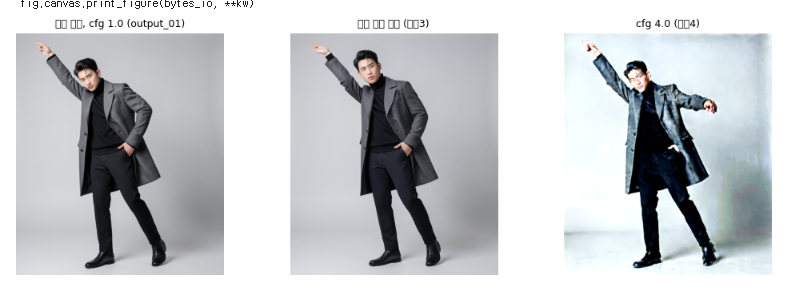

# 버그픽스: [9-2]·[9-3] 그림 제목이 □□로 깨짐

- 날짜: 2026-11-11
- 고친 파일: `pose_tool.ipynb` 셀 [9-2], [9-3] (코드 2줄)
- 발견: 첫 Colab 실행 중 ([실행 기록](../test/202611112103/README.md) 9장)

## 증상

[9-2]·[9-3]이 결과 이미지를 나란히 보여 줄 때, 각 그림 위의 제목이 □□□ 같은 네모로 나왔습니다.
셀 출력에는 matplotlib 경고(`fig.canvas.print_figure(...)` 줄)도 함께 찍혔습니다.



- 영향: **화면에 보이는 제목만** 깨졌습니다. 저장된 결과 파일(`samples/*.png`)과 생성 결과에는 영향이 없습니다.
- [8], [9-1]은 제목이 영어(`image 1: model`, `exp1_stage` 등)라서 문제가 없었습니다.

## 원인

matplotlib 의 기본 글꼴(DejaVu Sans)에는 한글 글자가 없습니다. Colab 런타임에도 한글 글꼴이 기본으로 설치돼 있지 않습니다.
[9-2]·[9-3]만 그림 제목을 한글(`"남자 × 발레 (output_01)"`, `"원본 사진 참조 (실험3)"` 등)로 적어서, 이 두 셀에서만 깨졌습니다.

## 고친 방법

선택지 두 개 중에서 1을 골랐습니다.

| | 방법 | 판단 |
|---|---|---|
| **1 (선택)** | 그림 제목을 영어로 바꾸기 | 코드 2줄만 바뀌고 설치가 필요 없습니다. 다른 셀의 제목도 이미 영어라 통일됩니다 |
| 2 | 한글 글꼴(예: 나눔고딕)을 설치하고 matplotlib 에 등록하기 | `apt` 설치와 글꼴 캐시 갱신이 더해지고, 런타임을 다시 시작해야 할 수도 있습니다. 노트가 길어지고 실행 시간도 늘어납니다 |

바꾼 내용:

```diff
 # [9-2]
-     ["남자 × 발레 (output_01)", "남자 × 댄스", "여자 × 발레", "여자 × 댄스 (output_02)"], h=3.2)
+     ["male x ballet (output_01)", "male x dance", "female x ballet", "female x dance (output_02)"], h=3.2)
 # [9-3]
-     ["뼈대 참조, cfg 1.0 (output_01)", "원본 사진 참조 (실험3)", "cfg 4.0 (실험4)"], h=3.5)
+     ["skeleton ref, cfg 1.0 (output_01)", "photo ref (exp3)", "cfg 4.0 (exp4)"], h=3.5)
```

## 확인

- 한 것: 노트의 모든 `show(...)` 호출을 검사했고, 그림 제목에 한글이 남아 있지 않습니다.
- 확인 못 한 것: 고친 노트를 Colab 에서 다시 실행해 보지는 않았습니다. 바꾼 것이 문자열뿐이라 동작은 같을 것으로 봅니다.
- 남은 주의점: 업로드하는 **사진 파일 이름**이 한글이면 [5]·[6]의 제목(파일 이름을 그대로 씀)도 같은 이유로 깨집니다. 저장소의 사진 이름은 모두 영어라서 이번에는 해당하지 않습니다.
