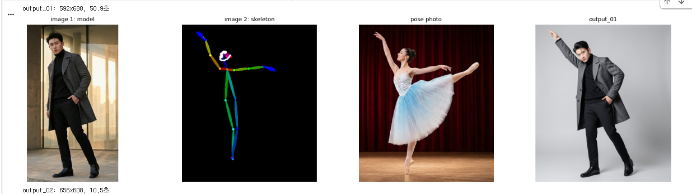
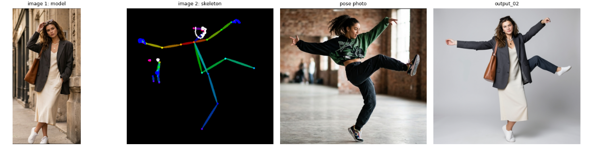
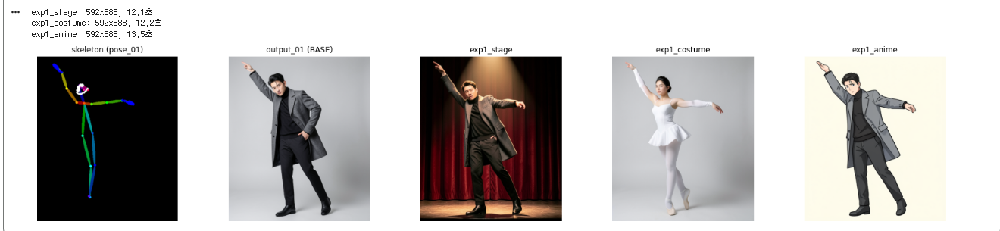
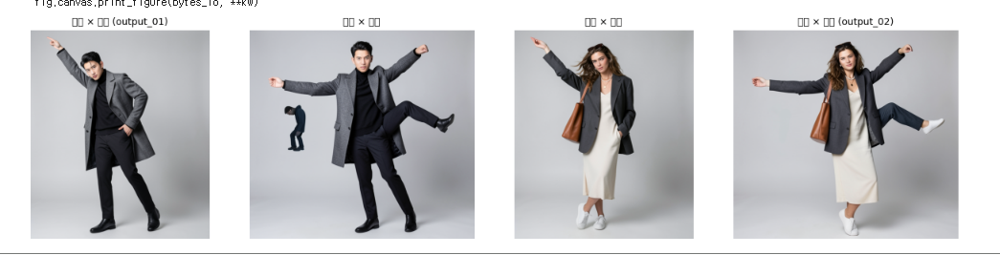
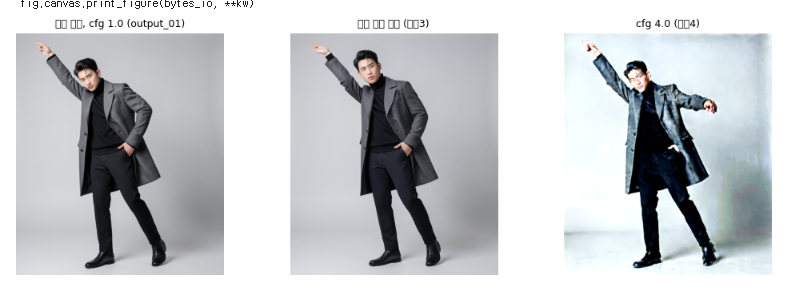

# 첫 Colab 실행 기록: 스크래치패드와 다리 세 개

- 날짜: 2026-11-11 (폴더 이름 `202611112103` = 21:03에 내려받은 결과)
- 누가: eple(브라우저 담당) + Claude Code(colab-mcp 로 셀 실행 담당)
- 환경: 무료 Colab, Tesla T4 (VRAM 14.6GB, RAM 12.7GB, 디스크 여유 112.5GB)
- 결과: 노트 셀 [1]~[10] 모두 성공. 오류도 OOM 도 없었고, 설정은 처음 값 그대로 썼습니다.

이 폴더에 있는 것

| 파일 | 내용 |
|---|---|
| `pose_tool_런타임용_202611112103.ipynb` | 실제로 실행한 노트(스크래치패드). 셀 출력이 그대로 들어 있습니다 |
| (`samples.zip`) | 노트 [10]이 내려받은 결과 묶음. `samples/` 와 내용이 같아 저장소에는 올리지 않았습니다. 압축을 푼 내용은 저장소의 [`samples/`](../../../samples) 에 있습니다 |
| `captures/` | 실행하면서 eple이 찍은 화면 5장 |

---

## 1. colab-mcp 가 엉뚱한 노트에 붙었다

계획은 간단했습니다. eple이 `pose_tool.ipynb` 를 Colab 에서 열고 T4 를 고르면, Claude 가 MCP 로 셀을 차례로 실행하는 것이었습니다.

그런데 `open_colab_browser_connection` 을 부르자, 연결된 노트에 **빈 셀 하나**만 있었습니다.

> eple: "응 니가 연건 스크래치 패드라고 적혀있네"

알고 보니 이 도구는 **이미 열린 노트에 붙지 않고, 새 Colab 탭(스크래치패드)을 열어 거기에 연결**합니다. eple이 원래 노트를 닫고 다시 시도해도, 결과는 또 스크래치패드였습니다. 이 과정에서 Claude 가 연결을 한 번 더 부르는 바람에 스크래치패드가 두 개 열리기도 했습니다.

> eple: "근데 너 하나 더 열었어?"

스크래치패드에 뜬 확인 창에서 실마리가 나왔습니다.

- "별도의 탭 연결"을 펼치면 **MCP 프록시 토큰**이 보입니다.
- 원하는 Colab 탭에서 **Ctrl+Shift+P → "로컬 Colab MCP 서버에 연결"**을 실행하고 토큰을 붙여 넣으면, 그 탭에 연결됩니다.
- 한 번에 노트 하나만 연결됩니다.

다만 연결 호출이 기다리는 동안 시간이 다 되어 false 로 끝나거나, 다음 호출에서는 확인 창 없이 스크래치패드가 바로 연결되는 등 순서를 맞추기가 까다로웠습니다.

> eple: "생각보다 어렵네"

**결정:** 원래 노트로 옮기는 것은 포기하고, **스크래치패드에서 돌리기로** 했습니다. Claude 가 로컬 `pose_tool.ipynb` 의 코드 셀 [1]~[10]을 스크래치패드에 그대로 복사해 넣었습니다. 셀 내용이 같아서 결과도 같습니다.

배운 것: colab-mcp 는 "열려 있는 노트를 조종한다"기보다 "자기가 연 노트를 조종한다"에 가깝습니다. 원하는 노트에 붙이려면 토큰과 명령 팔레트를 써야 합니다(`docs/mcp-setup.md` 에 반영할 거리).

## 2. GPU 없이 시작했다가 T4

[1]을 처음 실행하자 `GPU가 없습니다` 가 나왔습니다. 스크래치패드는 새 노트라서 런타임 유형이 기본값(CPU)이었습니다. eple이 T4 로 바꾼 뒤 다시 실행하니 통과했습니다.

```
GPU  : Tesla T4 / VRAM 14.6GB
RAM  : 12.7GB
디스크 여유: 112.5GB
```

## 3. 설치·다운로드·서버: 걱정했던 것보다 순조로움

- [2] 설치: 완료. `albumentations` 와 `albucore` 버전이 안 맞는다는 pip 경고가 있었지만, 이후 동작에는 지장이 없었습니다.
- [3] 모델 3개(약 5GB) 다운로드: 약 1분 (UNet 32초, VAE 4초, 텍스트 인코더 30초)
- [4] ComfyUI 서버 실행: 필요한 노드 8개가 **모두 있음**

## 4. 업로드를 두 번에 나눠 했다

[5]는 업로드 창이 두 번 뜹니다(모델 사진, 포즈 사진).

> eple: "포즈사진이 아니라 모델 사진을 고르라는데?"

첫 창이 모델 사진 창이 맞습니다. 그런데 각 창에서 한 장씩만 골라서, 4장 중 2장만 올라갔습니다. 셀을 다시 실행해 나머지 2장을 올렸더니, 파일은 4장 모두 `input/` 에 있지만 **변수에는 마지막 2장만** 남았습니다.

다시 올리지 않고, 스크래치패드에만 임시 셀을 하나 넣어 목록을 바로잡았습니다(짝 순서 pose_01=발레, pose_02=댄스 유지). 저장소의 노트는 고치지 않았습니다.

배운 것: 업로드 창에서는 **Ctrl+클릭으로 두 장을 함께** 골라야 합니다.

## 5. 30분 동안 아무 소식이 없었다

[6] 포즈 추출은 Colab 에서 **15초 만에** 끝났습니다(발레 12.0초, 댄스 3.0초). 그런데 MCP 가 결과를 Claude 에게 넘겨주지 못한 채 멈췄습니다.

> eple: "다음꺼하고있는거야?" / "너무 오래걸리는데?"

30분 뒤 타임아웃이 났고 MCP 연결도 끊겼습니다. 그림이 들어간 큰 출력을 넘기다 멈춘 것으로 보입니다(추측). 앞서 [5]의 출력도 약 39만~48만 자였습니다.

**결정:** 남은 [7]~[10]은 eple이 스크래치패드에서 **Ctrl+F10(이후 셀 실행)** 으로 직접 돌리고, 화면을 캡처해 보내 주기로 했습니다. 실제로 이게 가장 빨랐습니다.

배운 것: 그림을 많이 출력하는 노트는 MCP 로 한 셀씩 돌리기에 맞지 않습니다. 설치·다운로드처럼 글만 나오는 셀은 MCP 로, 생성 셀은 사람이 직접 돌리는 쪽이 낫습니다.

### 뼈대를 보니 이미 문제가 보였다

- 발레: 튀튀에 가려 **뒤로 든 다리가 빠졌습니다.** 두 다리가 모두 아래로 겹쳐 그려졌습니다.
- 댄스: 주인공 옆에 **배경 인물이 작은 뼈대로 하나 더** 잡혔습니다.

## 6. 결과: 여자 모델은 춤을 췄고, 남자 모델은 손을 주머니에 넣었다



**output_01 (남자 × 발레)**: 위로 뻗은 팔은 맞습니다. 하지만 옆 팔은 주머니에 들어가 있고, 다리는 그냥 서 있습니다. 첫 장이라 모델을 올리는 시간까지 50.9초가 걸렸습니다.



**output_02 (여자 × 댄스)**: 양팔을 벌리고 한 다리를 차올렸습니다. 재킷과 가방까지 그대로입니다. 10.5초.

노트에서 가장 걱정하던 위험, 즉 GGUF 텍스트 인코더가 `type "flux2"` 로 동작하는지는 **문제없이 통과**했습니다.

## 7. 실험 1: 프롬프트만 바꿨는데 팔이 펴졌다



무대·발레복·일러스트, 세 장 모두 output_01 보다 **팔이 뼈대에 더 가까웠습니다.** 같은 시드라도 문장이 바뀌면 팔 위치가 흔들린다는 뜻입니다.

반전은 발레복이었습니다. "흰 발레복을 입혀라"라고 하자 **남자 모델이 여성 발레리나가 됐습니다.** 옷 지시가 인물까지 덮어써 버린 것입니다.

## 8. 실험 2: 다리가 세 개



> eple: "9-2 이상해 ㅎㅎㅎ 남자 다리 세개야 ㅋ"

남자 × 댄스(왼쪽에서 두 번째)는 팔과 차올린 다리는 맞았습니다. 그런데 **서 있는 다리 두 개에 차올린 다리 하나**, 모두 세 개가 됐고, 왼쪽에는 **작은 사람이 하나 더** 생겼습니다.

- 작은 사람: [6]에서 잡힌 배경 인물의 뼈대를 그대로 그린 것입니다.
- 다리 세 개: 원래 모델 사진의 서 있는 다리와 뼈대의 차올린 다리가 함께 그려진 것 같습니다(추측). 원피스를 입은 여자 모델은 다리가 가려져 티가 덜 났습니다(추측).

웃겼지만 이 과제에서 가장 쓸모 있는 결과였습니다. **"뼈대 품질 = 결과 품질"**을 한눈에 보여 주기 때문입니다. 그리고 2×2 를 보면, 발레 뼈대는 남녀 모두 "위팔 하나 + 서 있기"를, 댄스 뼈대는 남녀 모두 "양팔 + 킥"을 만들었습니다. 자세를 정하는 것은 프롬프트가 아니라 뼈대였습니다.

## 9. 실험 3·4: 원본 사진은 의외로 얌전했고, cfg 4 는 타 버렸다



> eple: "9-3은 뭔가 설명 글씨가 깨졌어"

먼저 그림 제목이 □□로 깨진 것은 Colab 에 한글 글꼴이 없기 때문입니다. 결과 파일에는 영향이 없습니다. 따로 버그픽스로 고쳤습니다([../../bugfix/2026-11-11-korean-plot-titles.md](../../bugfix/2026-11-11-korean-plot-titles.md)).

- **실험 3 (원본 포즈 사진 참조)**: 튀튀나 커튼이 섞일 줄 알았는데, output_01 과 **거의 같았습니다.** 참조 2가 결과에 주는 힘 자체가 약한 것으로 보입니다(추측).
- **실험 4 (cfg 4.0)**: 대비가 과하고 배경이 하얗게 날아갔습니다. 시간도 21.1초로 약 2배였습니다. 증류 모델에는 cfg 1.0 이 맞습니다.

## 10. 정리

| 항목 | 결과 |
|---|---|
| 노트 동작 | [1]~[10] 모두 성공, 설정 변경 없이 무료 T4 에서 OOM 없음 |
| 속도 | 첫 장 50.9초, 이후 10~14초, cfg 4.0 은 21.1초 |
| 자세 옮기기 | 댄스는 대체로 성공. 발레는 팔만 일부 성공(뼈대에서 다리가 빠짐) |
| 가장 큰 교훈 | 결과는 뼈대 품질에 달려 있다. 생성 전에 뼈대를 꼭 눈으로 확인할 것 |
| MCP 교훈 | 스크래치패드에 연결된다. 그림 출력이 많은 셀은 사람이 직접 돌리는 게 빠르다 |

자세한 관찰은 노트 셀 [11], 실행 표는 [prompts.md](../../../prompts.md), 요약은 [README](../../../README.md#테스트-결과) 에 있습니다.
